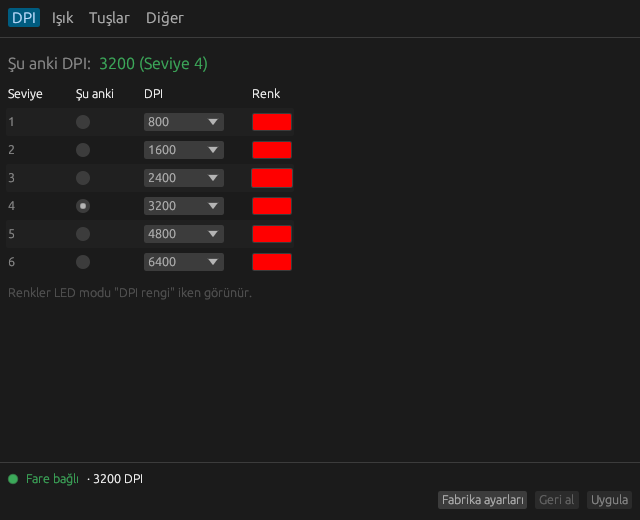
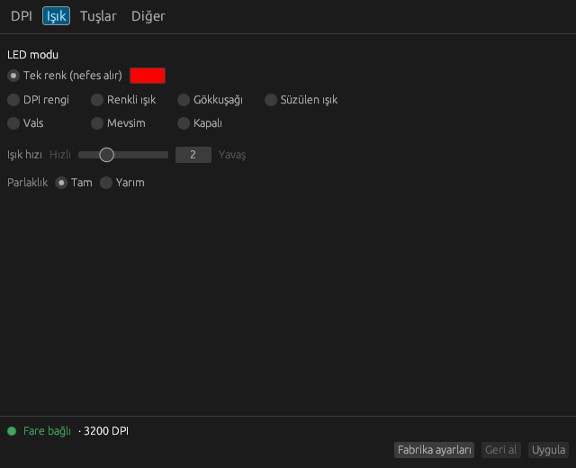
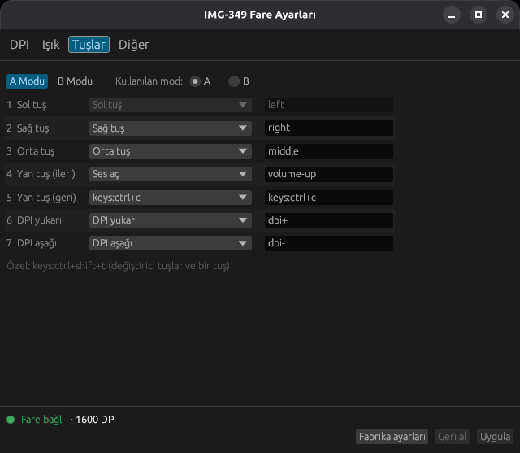

# img349ctl

**Türkçe** | [English](README.en.md)

**Inca IMG-349** oyuncu faresini Linux'ta, üreticinin Windows programına gerek
kalmadan ayarlayın. Hem komut satırı aracı (`img349ctl`) hem de Türkçe arayüzlü
bir pencere uygulaması (`img349ctl-gui`) olarak gelir.

<p>
  
  
  
</p>

> Bu yeni bir proje ve şimdilik tek bir farede denendi. Neyin doğrulandığı
> [aşağıda](#farede-denenenler) yazıyor. Sorunları bir
> [issue](https://github.com/EmreYavuzalp/Inca-IMG349-Linux/issues) ile bildirin.

## Neler yapabilir?

- 6 DPI seviyesi (200-6400): değerleri ve renkleri değiştirme, seviyeler arasında geçme
- Şu anki DPI'ı görme: farenin DPI tuşlarıyla yapılan değişiklikler de okunur
- LED modları: tek renk, DPI rengi, renkli ışık, gökkuşağı, süzülen ışık, vals, mevsim, kapalı; hız ve parlaklık
- 7 tuşa işlev atama, A ve B modu için ayrı ayrı: fare tuşları, DPI, ateş, medya, web, bilgisayar işlevleri ve klavye kısayolları
- Rapor oranı: 125, 250, 500 ya da 1000 Hz
- Arayüz sistem diliniz Türkçeyse Türkçe açılır, Wayland ve X11'de çalışır

Fare ayarlarını kendi hafızasında tutar ve geri okutabilir, bu yüzden ayar dosyası
ya da arka plan servisi yoktur. Medya tuşları ve kısayollar da farenin içinde çalışır.

## Henüz olmayanlar

- Makrolar
- Ateş tuşunun tekrar sayısı ve aralığı (hazır 3 ateş modu atanabilir)
- Üreticinin programındaki "Hareket hızı", "Çift tıklatma hızı" ve "Hız haddeleme":
  fareye yazmıyorlar, büyük ihtimalle Windows ayarları

## Kurulum

[Son sürümden](https://github.com/EmreYavuzalp/Inca-IMG349-Linux/releases/latest)
`.deb` dosyasını indirin:

```sh
sudo apt install ./img349ctl_*_amd64.deb
```

Sonra fareyi çıkarıp tekrar takın. Menüde **IMG-349 Fare Ayarları** görünür.

Kaynaktan derlemek için Rust 1.81 ya da sonrası gerekir:

```sh
git clone https://github.com/EmreYavuzalp/Inca-IMG349-Linux
cd Inca-IMG349-Linux
cargo build --release --features gui
sudo install -m 644 contrib/70-img349-mouse.rules /etc/udev/rules.d/
sudo udevadm control --reload-rules
sudo udevadm trigger --subsystem-match=hidraw
```

## Komut satırı

Ayar değiştiren her komut yalnızca değişen kısmı fareye yazar ve geri okuyarak kontrol eder.

| Komut | Ne yapar |
|---|---|
| `img349ctl status` | fareyi ve ayarlarını gösterir |
| `img349ctl dpi SEVİYE DEĞER` | bir seviyeyi (1-6) 200/400/600/800/1000/1200/1600/2000/2400/3200/4800/6400 yapar |
| `img349ctl level SEVİYE` | o DPI seviyesine geçer |
| `img349ctl color SEVİYE RENK` | `ff8000`, `#f80` ya da renk adı; seviye yerine `all` da olur |
| `img349ctl single RENK` | tek renk: DPI rengi modunda bütün seviyeler bu renge ayarlanır; ışık nefes almaya devam eder |
| `img349ctl led MOD` | `dpi`, `colorful`, `rainbow`, `floe`, `waltz`, `seasons`, `off` |
| `img349ctl led --speed N` | ışık hızı, 0 en hızlı, 7 en yavaş |
| `img349ctl led --half` / `--full` | parlaklık |
| `img349ctl rate HZ` | rapor oranı; fare bir an bağlantıyı kesip yeniden başlar |
| `img349ctl button TUŞ İŞLEV [--mode b]` | tuşa (1-7) işlev atar |
| `img349ctl mode a` / `b` | kullanılan modu seçer |
| `img349ctl actions` | atanabilecek işlevleri listeler |
| `img349ctl reset` | ayarları fabrika değerlerine döndürür |
| `img349ctl backup DOSYA` | farenin tüm hafızasını dosyaya yedekler |

`-n` seçeneği raporları fareye göndermeden yazdırır. Klavye kısayolu için
`img349ctl button 5 keys:ctrl+c` gibi yazın; değiştirici tuşların yanında tek bir tuş olabilir.

## Güvenlik

Farenin hafızasında firmware de durur, bu yüzden yanlış bir yazma fareyi bozabilir.
Program yalnızca haritalanan ayar adreslerine yazar, hafıza beklenen gibi görünmezse
yazmayı reddeder. A modunda sol tuş, üreticinin programında olduğu gibi değiştirilemez.
Yine de garanti verilmez, kullanım sorumluluğu size aittir.

"Fabrika ayarları", yeni bir fareden okunan değerlerdir. Üreticinin "Yeniden Başlat"
düğmesinin hafızaya ne yazdığı incelenmedi.

## Farede denenenler

**Doğrulandı (yazılıp geri okundu):** DPI değeri ve seviyesi, renkler, LED modu, hız ve
parlaklık, tuş atamaları, A/B modu, rapor oranı.

**Fare yapamıyor:** sabit ışık. Tek renk seçilince de ışık nefes alır; firmware bunu kapatan bir mod kabul etmiyor.

**Farede gözle doğrulandı:** DPI rengi modunda renkler, hareketli LED modlarında ışığın renk değiştirmesi.

**Henüz doğrulanmadı:** LED modlarının birbirinden farkı, atanan tuşların gerçekten
çalışması ve DPI tuşlarına basınca pencerenin güncellenmesi.

Debian 13'te, `1bcf:08b8` kimlikli tek bir farede denendi. Fare `lsusb` çıktısında
Sunplus "HID Gaming Mouse" olarak görünür.

## Lisans

BSD-3-Clause. Inca ile bağlantısı yoktur.
